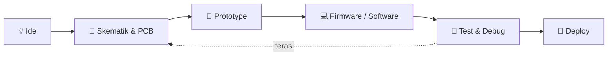

<!-- ======================= HEADER ======================= -->
<div align="center">


<br/>

<a href="https://git.io/typing-svg">
  
</a>

<br/>


</div>

---

## 👨‍💻 Tentang Saya

```cpp
#include <Adji.h>

class Adji : public Engineer  // ADJI project {
  public:
    String role[2]    = {"Electronic Engineer", "Software Developer"};
    String focus[4]   = {"Embedded Systems", "IoT", "PCB Design", "Industrial Automation"};
    String favorite[3]= {"Arduino Uno", "Espressif (ESP32)", "Raspberry Pi"};
    String motto      = "If it blinks, ship it. If it doesn't, debug it.";

    void loop() {
      design();  // skematik & PCB
      code();    // firmware & software
      test();    // ukur, debug, perbaiki
      deploy();  // sampai berjalan di lapangan
    }
};
```

- 🔭 Sedang membangun sistem **IoT & monitoring** berbasis ESP32 dan Raspberry Pi
- 🌱 Terus belajar: **Embedded C/C++, Python, PCB layout, dan integrasi industri**
- ⚡ Suka menghubungkan dunia **hardware ↔ software** menjadi satu sistem yang utuh
- 🤝 Terbuka untuk kolaborasi proyek **embedded, IoT, dan otomasi**

---

## 🛠️ Technical Skill Matrix

<table>
  <tr>
    <th align="left">Category</th>
    <th align="left">Tools &amp; Technologies</th>
  </tr>
  <tr>
    <td><b>Microcontrollers</b></td>
    <td>
      
      
      
      
    </td>
  </tr>
  <tr>
    <td><b>PCB Design</b></td>
    <td>
      
      
      
      
      
      
    </td>
  </tr>
  <tr>
    <td><b>Mechanical CAD</b></td>
    <td>
      
      
      
    </td>
  </tr>
  <tr>
    <td><b>Industrial Tech</b></td>
    <td>
      
      
      
      
    </td>
  </tr>
  <tr>
    <td><b>Languages</b></td>
    <td>
      
      
      
    </td>
  </tr>
</table>

---

## ⚙️ Workflow Saya



---

## 📊 GitHub Stats

<div align="center">


<br/>


</div>

---

## 📌 Featured Projects

| Proyek | Deskripsi | Tech |
|---|---|---|
| 🌡️ **Smart Monitoring** | Monitoring suhu & kelembapan real-time via MQTT |   |
| 🏠 **Home IoT Hub** | Server rumahan untuk kontrol & hosting perangkat IoT |  |
| 🎮 **Mini Game Console** | Game retro di layar OLED dengan satu tombol |   |
| ⚡ **Power Monitor** | Pengukuran listrik 3 fasa lewat Modbus RTU |  |

> ✏️ *Ganti isi tabel di atas dengan proyek asli kamu, lalu tambahkan link repo-nya.*

---

## 🐍 Contribution Snake

<div align="center">
  
</div>

---

## 📫 Hubungi Saya

<div align="center">

[](mailto:EMAIL_KAMU@example.com)
[](https://linkedin.com/in/USERNAME_LINKEDIN)
[](https://instagram.com/USERNAME_IG)

<br/>


*⚡ "Hardware is the body, software is the soul."*

</div>
