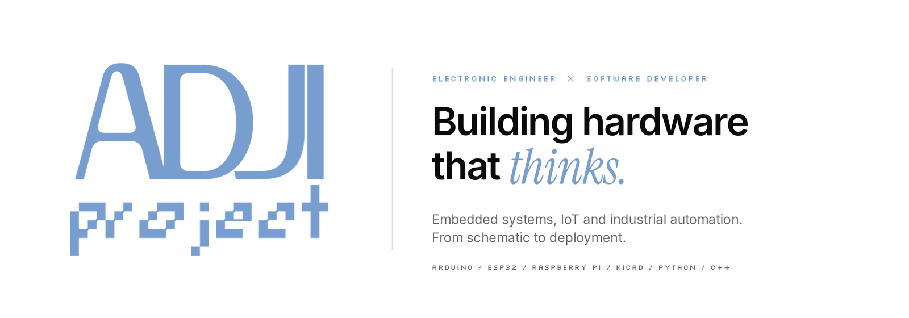

<div align="center">

<picture>
  <source media="(prefers-color-scheme: dark)" srcset="./hero-dark.png">
  
</picture>

<br/>

<a href="https://git.io/typing-svg">
  
</a>

</div>

---

### 💫 Hi 👋, I'm Adji

📩 Email me at [arcenixtermux@gmail.com](mailto:arcenixtermux@gmail.com) for collaboration, embedded & IoT projects, or anything else 😊

- 🔭 **Electronic Engineer & Software Developer** — designing embedded hardware, writing firmware, and building software so devices work reliably from the bench to the field.
- 🌱 Currently building with **Arduino**, **Espressif (ESP32 family)**, **Raspberry Pi**, and **Python/C++** tooling.
- 🛠️ Open to collaboration on **Embedded Systems, IoT, PCB Design, and Industrial Automation**.
- 📫 How to reach me: [arcenixtermux@gmail.com](mailto:arcenixtermux@gmail.com)
- ⚡ Fun fact: *Hardware works on the breadboard, fails on the PCB, and magically fixes itself the moment you touch the oscilloscope probe.* 🔌

---

### 💻 Tech Stack:


---

### 🌐 Socials:

[](https://linkedin.com/in/sutan-alamsyah-lindu-adjie)
[](mailto:arcenixtermux@gmail.com)
[](https://instagram.com/prammadia_qubrix)

---

### 🏆 GitHub Trophies

<p align="left">
  <a href="https://github.com/arceniexa-dev">
    
  </a>
</p>

---

### 🚀 Featured Projects & Engineering Highlights

Building end-to-end hardware and software systems across IoT, industrial automation, and embedded graphics.

#### 🛠️ Selected Work
- 🌡️ **[IOT-NodeMCU-Temperature-Humidity-](https://github.com/arceniexa-dev)** — Server rack environmental monitoring with ESP8266 + DHT22, MQTT telemetry, Telegram alerts, OTA updates, and remote threshold config.
- 🌾 **[ESP32-Lora-Agri-Multinode](https://github.com/arceniexa-dev)** — Self-sustaining remote farm monitoring solution using ESP32 sensor nodes, long-range LoRa transmission, Modbus RTU, and a Wi-Fi gateway.
- 🎮 **[ESP32-C3-Tactical-Arcade-Game](https://github.com/arceniexa-dev)** — Native C++ DOOM-style 3D raycaster engine on ESP32-C3 SuperMini + 0.96" OLED without requiring PSRAM.
- 🖥️ **[DCIM Web Application](https://github.com/arceniexa-dev)** — Full-stack data center infrastructure management tool containerized with Docker for tracking racks, devices, and capacity.

#### ⚙️ Engineering Focus

`Embedded & IoT` · `ESP32 & STM32` · `PCB Design (KiCad / Altium)` · `PLC & SCADA` · `Modbus RTU` · `MQTT & LoRa` · `Python & C++` · `Docker & Grafana`

#### 🔄 Engineering Workflow

```mermaid
flowchart LR
    A[Requirements] --> B[Schematic & PCB]
    B --> C[Prototype]
    C --> D[Firmware & Software]
    D --> E[Test & Debug]
    E --> F[Deploy & Monitor]
    E -. iterate .-> B
