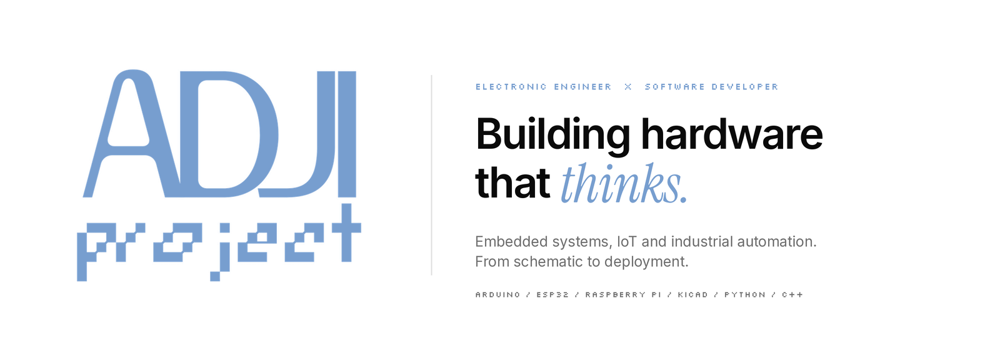
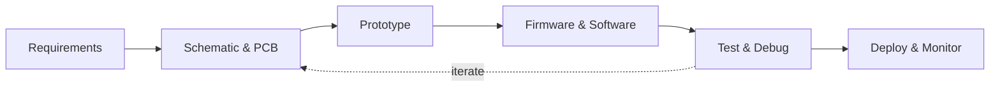

<picture>
  <source media="(prefers-color-scheme: dark)" srcset="./hero-dark.png">
  
</picture>

 

  

 

## About

I'm **Adji**, an electronic engineer and software developer. I design embedded hardware, write the firmware that runs on it, and build the software around it, so a device doesn't just work on the bench but keeps working in the field.

My day-to-day platforms are **Arduino**, **Espressif (ESP32 family)** and **Raspberry Pi**, backed by PCB design, industrial protocols, and Python/C++ tooling.

 

## Focus Areas

<table>
  <tr>
    <td width="33%" valign="top">
      <h4>Embedded &amp; IoT</h4>
      Firmware for Arduino, ESP32 and STM32. Sensor nodes, MQTT messaging, wireless connectivity, and low-power design.
    </td>
    <td width="33%" valign="top">
      <h4>Hardware &amp; PCB</h4>
      Schematic capture and board layout in KiCad, Altium and EasyEDA. Circuit simulation, prototyping, and enclosure design.
    </td>
    <td width="33%" valign="top">
      <h4>Industrial &amp; Software</h4>
      PLC, HMI/SCADA and Modbus RTU integration. Dashboards, bots and web tools in Python to make field data useful.
    </td>
  </tr>
</table>

 

## Technical Stack

 

<table>
  <tr>
    <th align="left" width="22%">Category</th>
    <th align="left">Tools &amp; Technologies</th>
  </tr>
  <tr>
    <td><b>Microcontrollers</b></td>
    <td>
      
      
      
      
    </td>
  </tr>
  <tr>
    <td><b>PCB Design</b></td>
    <td>
      
      
      
      
      
      
    </td>
  </tr>
  <tr>
    <td><b>Mechanical CAD</b></td>
    <td>
      
      
      
    </td>
  </tr>
  <tr>
    <td><b>Industrial Tech</b></td>
    <td>
      
      
      
      
    </td>
  </tr>
  <tr>
    <td><b>Languages</b></td>
    <td>
      
      
      
    </td>
  </tr>
</table>

 

## Selected Work

<table>
  <tr>
    <td width="50%" valign="top">
      <h4>IOT-NodeMCU-Temperature-Humidity-</h4>
      IoT environmental monitoring for server racks using ESP8266 + DHT22. Publishes temperature/humidity to MQTT, sends alerts via Telegram, supports OTA updates, and remote threshold configuration..  
      
      
      
    </td>
    <td width="50%" valign="top">
      <h4>3-Phase Power Monitoring</h4>
      Electrical measurement over Modbus RTU using PZEM-004T modules and an ESP32 gateway.  
      
      
    </td>
  </tr>
  <tr>
    <td width="50%" valign="top">
      <h4>ESP32-C3-Tactical-Arcade-Game</h4>
      DOOM-style raycaster engine for ESP32-C3 SuperMini + 0.96" OLED. Native, no PSRAM required. Walk, turn, and shoot in a tiny 3D maze.  
      
      
    </td>
    <td width="50%" valign="top">
      <h4>DCIM Web Application</h4>
      Full-stack data center infrastructure management tool for tracking racks, devices and capacity.  
      
      
    </td>
  </tr>
</table>

> Replace or link these cards to your own repositories, e.g. `[Rack Environment Monitoring](https://github.com/USERNAME/REPO)`.

 

## Engineering Workflow

 

## GitHub Activity

<picture>
  <source media="(prefers-color-scheme: dark)" srcset="https://github-readme-stats.vercel.app/api?username=arceniexa-dev&show_icons=true&theme=transparent&title_color=779ECF&icon_color=779ECF&text_color=c9d1d9&hide_border=true">
  
</picture>
<picture>
  <source media="(prefers-color-scheme: dark)" srcset="https://github-readme-stats.vercel.app/api/top-langs/?username=arceniexa-dev&layout=compact&theme=transparent&title_color=779ECF&text_color=c9d1d9&hide_border=true">
  
</picture>

 

## Contact

 

